# City Air Tracker

Hourly air quality data for 50 U.S. cities, one per state. Pulled from the OpenWeather API, stored in PostgreSQL on AWS RDS, shown through a Dash dashboard with an AI assistant built in. Deployed live on Render.

This project was used as an example project for the Code the Dream Python Practicum.

**Live app:** [city-air-tracker.onrender.com](https://city-air-tracker.onrender.com)

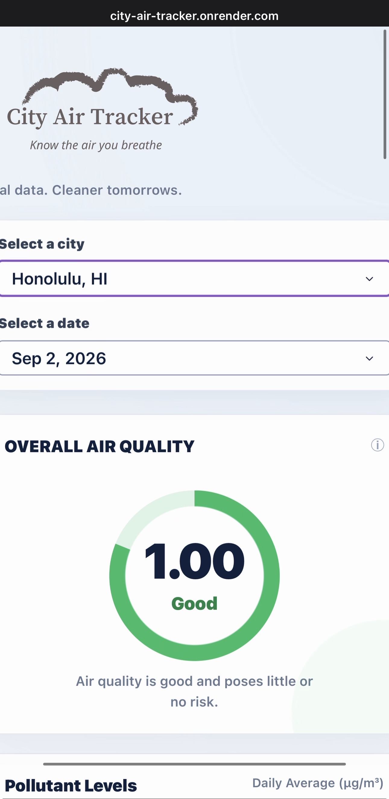

---

## What this does

Pulls hourly AQI readings for 50 cities across all 50 states and loads them into RDS, backfilled from January 1, 2026 and kept current with a daily scheduled pull. The dashboard reads directly from that data. The AI assistant built into the dashboard answers questions about air quality for whatever city and date you pick.

Scale: 50 cities x 24 readings a day = 1,200 rows a day, around 290,000 rows total from Jan 1, 2026 to now. About 1,500 API calls a month against a 1,000,000 limit. Runs on free tiers, so cost is close to $0.

---

## Features

- Hourly air quality for 50 U.S. cities, one per state, loaded from January 1, 2026 and updated every day
- An interactive dashboard: AQI gauge, pollutant levels, hourly chart, best and worst readings, and AQI distribution
- An AI assistant that answers questions about the selected city and date
- Safe to re-run: a unique constraint stops duplicate rows
- Live on Render, with the database locked down to approved IPs only
- Tests for the key logic

---

## Built with

- **Language:** Python
- **Data:** OpenWeather Geocoding and Air Pollution APIs, pandas
- **Database:** PostgreSQL on AWS RDS
- **Dashboard:** Dash and Plotly, custom CSS
- **AI:** Google Gemini API
- **Scheduling:** cron
- **Hosting:** Render
- **Testing:** pytest

---

## How it works

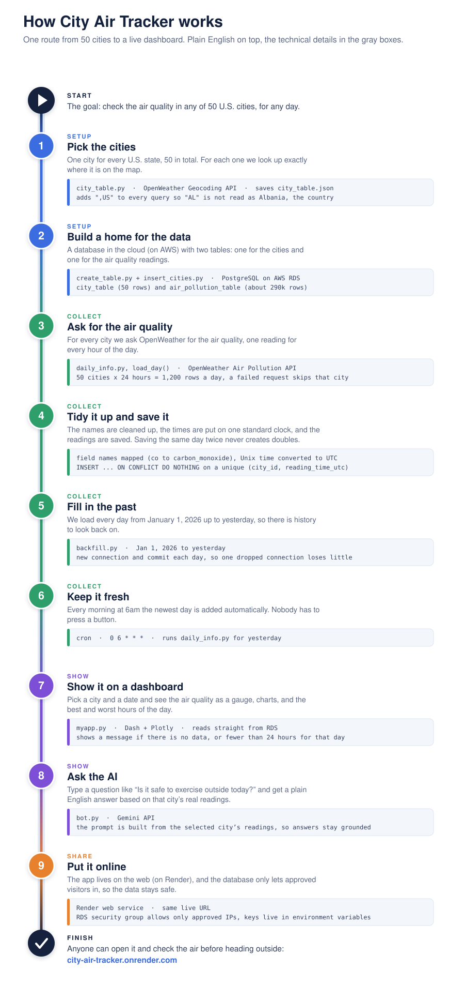

<details>
<summary>For the technical details, see the step by step flowchart for loading the data</summary>

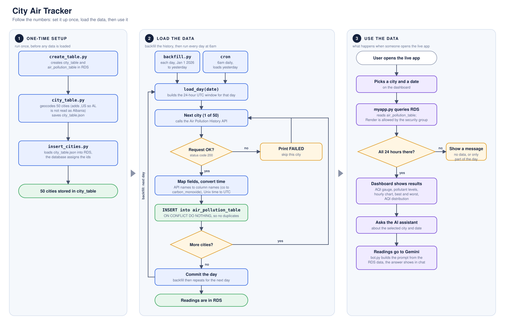

A quick note on the diamond that says "Request OK?": status 200 is the standard web code for "the request worked". `load_day()` checks it for every city. If the API sends back anything else, it prints FAILED for that city and moves on to the next one instead of stopping the whole run.

</details>

---

## Project structure

```
city-air-tracker/
  assets/             dashboard styling (style.css) and logos
  docs/               diagrams used in this README
  screenshots/        before and after screenshots
  extract/
    city_table.py
    daily_info.py
  load/
    create_table.py
    insert_cities.py
  orchestration/
    backfill.py
  tests/
    test_extract_lilly.py
    test_field_mapping.py
  myapp.py
  bot.py
  requirements.txt
  .env.example
  LICENSE
```

| File | What it does |
|---|---|
| `extract/city_table.py` | Looks up all 50 cities with the OpenWeather Geocoding API and saves them to `city_table.json`. It adds `,US` to every query so state codes like `AL` aren't read as countries (Albania). |
| `extract/daily_info.py` | `load_day()` pulls the 24 hourly readings for a date across all cities and inserts them into `air_pollution_table`. `build_time_window()` and `map_pollution_fields()` are pulled out as their own functions so they can be tested without a live API or database. |
| `load/create_table.py` | Creates `city_table` and `air_pollution_table`. |
| `load/insert_cities.py` | Loads `city_table.json` into `city_table`, lets the database assign the ids, then prints the table so you can check it. |
| `orchestration/backfill.py` | Runs `load_day()` for every day from Jan 1, 2026 to yesterday. It opens a fresh connection each day and commits after each one, so a dropped connection doesn't lose the whole run. |
| `tests/` | `test_extract_lilly.py` checks the 24 hour UTC time window. `test_field_mapping.py` checks that API field names map to the right columns, including zero values. |
| `myapp.py` | The dashboard. |
| `bot.py` | The AI assistant. It reads a city's readings from RDS and asks Gemini for a summary and health advice. |

A unique constraint on `city_id` and `reading_time_utc` means loading the same day twice never creates duplicates.

Run the tests from the repo root with `pytest`. The `extract/` and `tests/` folders each need an empty `__init__.py` so the imports resolve.

---

## Database schema

**city_table**

| Column | Type | Notes |
|---|---|---|
| city_id | SERIAL, primary key | |
| city_name | VARCHAR(100) | |
| state | CHAR(2) | |
| lat | NUMERIC(9,6) | |
| lon | NUMERIC(9,6) | |

Unique constraint on `(city_name, state)`.

**air_pollution_table**

| Column | Type | Notes |
|---|---|---|
| id | BIGSERIAL, primary key | |
| aqi | INT | |
| city_id | INT, references city_table | |
| reading_time_utc | TIMESTAMP | |
| carbon_monoxide | NUMERIC | |
| nitric_oxide | NUMERIC | |
| nitrogen_dioxide | NUMERIC | |
| ozone | NUMERIC | |
| sulfur_dioxide | NUMERIC | |
| fine_particles | NUMERIC | |
| coarse_particles | NUMERIC | |
| ammonia | NUMERIC | |

Unique constraint on `(city_id, reading_time_utc)`.

---

## Dashboard design: before and after

The dashboard started as a basic Dash app, simple charts with a date and a city dropdown, running locally. I redesigned it from scratch into the product you see above, and deployed it.

**Before:**

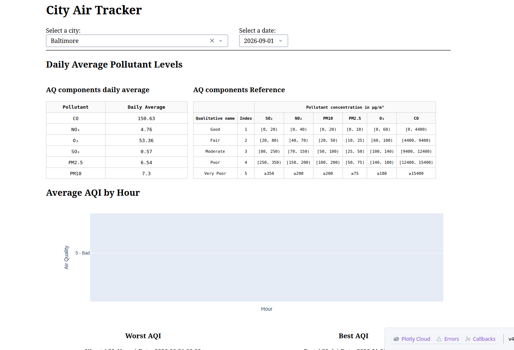
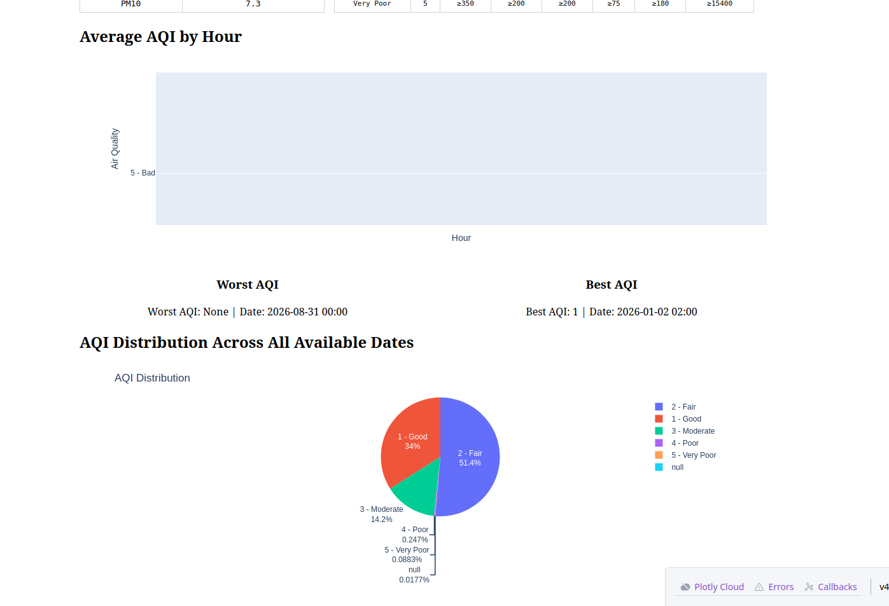

What changed:

- A real CSS stylesheet with one consistent color system instead of default styling
- Card based layout, rounded corners, shadows, consistent spacing
- City Air Tracker branding and a logo
- A circular AQI gauge with five visual states, colors matched across the gauge, the guide, and the best/worst cards
- A clean pollutant panel for PM2.5, PM10, O3, NO2, SO2, CO
- Fixed a dropdown bug where the city options were rendering behind other cards
- Fully responsive, layout collapses on mobile and the AI input goes vertical
- Error handling so an API issue shows a message instead of crashing the dashboard
- Deployed live on Render

**After:**

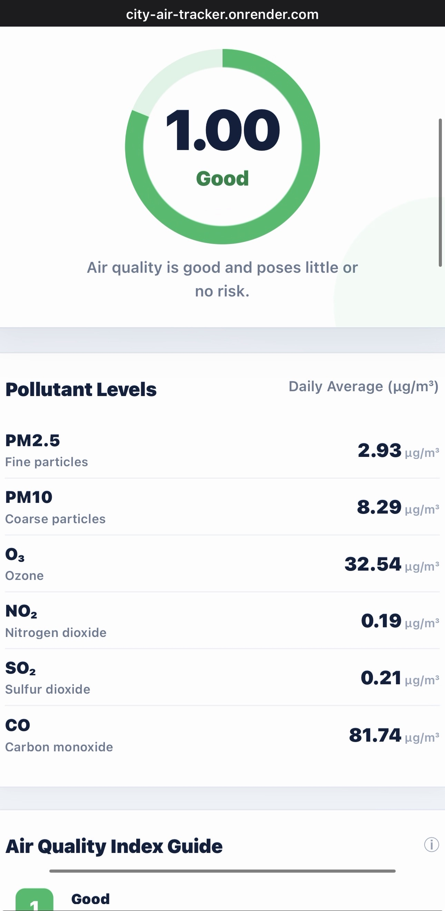
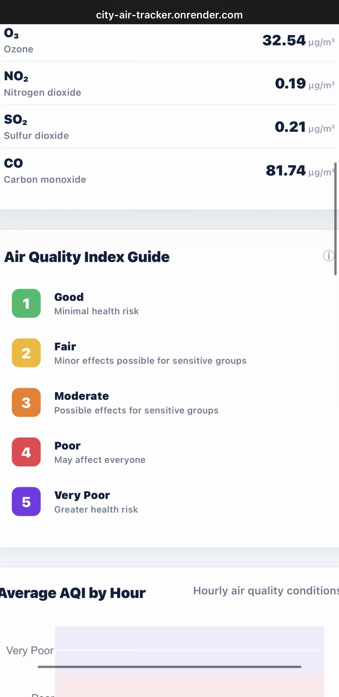
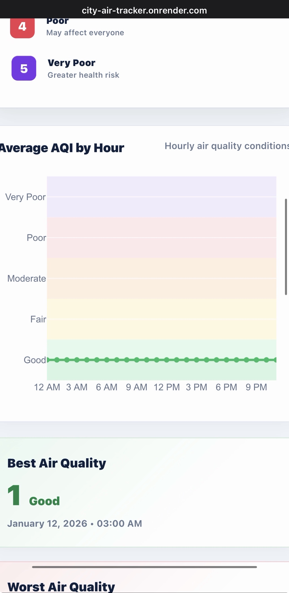
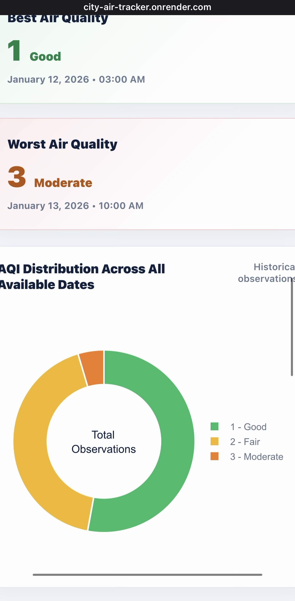
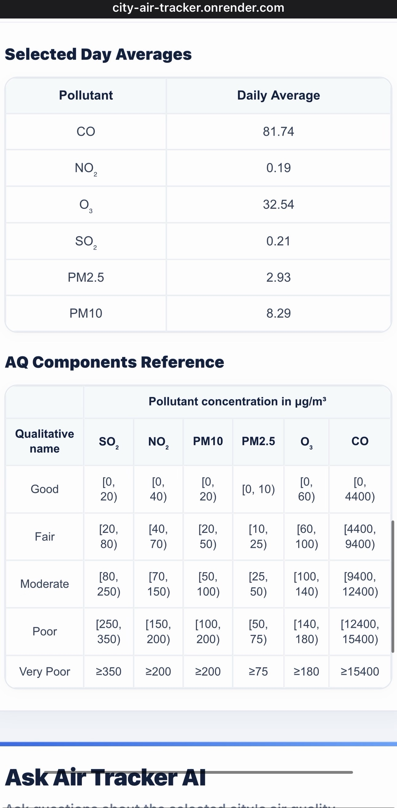

## The AI assistant

Not a button that spits out a canned summary. A real conversational assistant built into the dashboard. Chat history, an input box, an Ask button, separate styling for user messages vs AI messages.

Answers are grounded in the specific city and date selected, not general knowledge. The prompt tells the model the AQI scale here is a simple 1 to 5 scale, not the EPA's 0 to 500 scale, otherwise the model makes up EPA style numbers on its own.

Example questions it handles:
- "Is it safe to exercise outside today?"
- "Why is the AQI high?"
- "What pollutant is affecting this city?"
- "Should children spend time outside?"

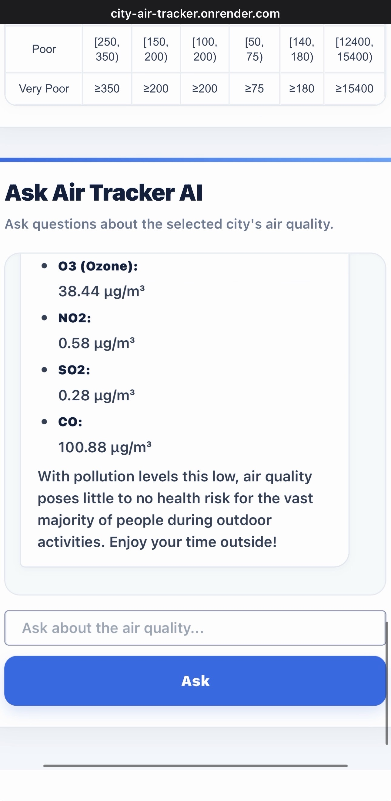

`bot.py` pulls the readings for a chosen city and date range straight from `air_pollution_table` joined to `city_table`, then sends that data to Gemini (`gemini-3.6-flash`) with two separate prompts, one for a plain language summary, one for general health precautions for sensitive groups (children, older adults, people with asthma), clearly labeled as not medical advice. Date range is capped at 14 days so it doesn't blow past the model's token limit. Bad dates, a start date after the end date, or too wide a range all get rejected with a clear message instead of the app just failing.

One deployment quirk worth knowing: the Gemini key I used locally hit its token limit during testing, and Gemini ties that limit to the project the key belongs to, not the environment. So the same key couldn't just be reused on Render, it would already be maxed out. The fix was generating a separate API key specifically for the deployed app, which is what actually lets the AI assistant respond once it's live instead of quietly failing.

---

## Setup

You'll need Python 3.12 and these packages, all listed in `requirements.txt`:

| Package | What it's for |
|---|---|
| `dash`, `plotly`, `pandas` | the dashboard, charts, and data handling |
| `psycopg`, `psycopg2-binary` | talking to the PostgreSQL database |
| `requests` | calling the OpenWeather APIs |
| `python-dotenv` | reading your keys from the `.env` file |
| `google-genai` | the Gemini AI assistant |
| `pytest` | running the tests |

1. Clone the repo
```bash
git clone https://github.com/<your-username>/city-air-tracker.git
cd city-air-tracker
pip install -r requirements.txt
```

2. Set up your `.env`
```
OPENWEATHER_API_KEY=
DB_Host=
DB_Port=5432
DB_Name=
DB_USER=
DB_PASSWORD=
GEMINI_API_KEY=
```

3. Create the tables
```bash
python load/create_table.py
```

4. Load the cities
```bash
python load/insert_cities.py
```
Inserts the cities and lets the database assign the id, then prints out what's in the table so you can check it loaded right.

5. Backfill historical data
```bash
python orchestration/backfill.py
```
Loads daily data from January 1, 2026 through yesterday. Safe to run more than once, the unique constraint stops duplicates and lets it pick back up clean if it gets interrupted.

6. Schedule the daily pull
```bash
python extract/daily_info.py
```
Set up on cron so it runs on its own:
```
0 6 * * * cd /path/to/city-air-tracker && /path/to/.venv/bin/python extract/daily_info.py >> daily.log 2>&1
```
Only runs if the machine it's on is awake, that's the tradeoff of running cron locally instead of on a server.

7. Run the tests
```bash
pytest
```
Runs `test_extract_lilly.py` and `test_field_mapping.py`, neither needs a live API or database connection, both test pure logic pulled out of `daily_info.py`.

8. Run the app
```bash
python myapp.py
```

9. Deploy on Render

The live app runs as a Render web service built from this repo:

- **Build Command:** `pip install -r requirements.txt`
- **Start Command:** `python myapp.py`
- **Environment variables:** the same values as your `.env` (database settings and API keys)
- **Database access:** add Render's IP to the RDS security group so the app can reach the database

---

## Security

- RDS security group only allows connections from specific IPs, scoped individually, never open to everyone
- Each person gets their own read only database user instead of sharing one master login
- Keys and DB credentials stay in `.env`, never committed to the repo

---

## Known issues

**Birmingham, AL got read as Albania. Already fixed.** The geocoding API took `AL` as the country code for Albania instead of the state code, came back empty, and crashed with an IndexError. About 1 in 5 state codes collide with country codes this way (DE, IN, LA, MD, MT, CO). Fixed in `city_table.py` by appending `,US` to every city query before hitting the geocoding endpoint.

**The 1 + 23 gap. My finding: it's an upstream API issue, not a bug in this code.** Some days show only 1 record instead of 24, always immediately followed by a day with 23 instead of 24, one day's readings splitting across two calendar dates. While debugging I traced it to specific rows (12 null rows for Baltimore at one point) and ruled out my code as the cause. Different cities hit it on different dates, which points to something on OpenWeather's end, not a shared bug here. Re-requesting those specific hours comes back empty, that data is just gone from the provider.


---

## Common questions

**Why not Lambda or EC2 for the scheduler?**
The daily job takes about 50 seconds. An EC2 instance would sit idle almost all the time. Lambda plus Secrets Manager is the planned next step. The database decouples the scheduler from everything downstream, so switching it later doesn't touch the dashboard or the AI assistant.

**What happens if the load runs twice?**
Nothing changes, the unique constraint blocks duplicate rows. That's also why the backfill was able to pick back up after a dropped connection.

**How do you know the data is right?**
50 cities times 24 hours should be 1,200 rows a day. Any other number is a red flag.

**Why keep incomplete data instead of dropping it?**
It gets stored as is and filtered when it's read. Dropping a row at load time just because one field is missing throws away good pollutant readings along with it.

**Why is AQI shown as 1 to 5?**
OpenWeather's API returns air quality as a 1 to 5 index (1 Good, 2 Fair, 3 Moderate, 4 Poor, 5 Very Poor). I kept that simple scale instead of converting it to the EPA's 0 to 500 scale, because I wanted something anyone could read at a glance, and I built the gauge, colors, and guide around it. It's labeled everywhere in the app so it's not confused with the standard scale.

**How does the frontend get new data?**
It queries RDS directly. When the 6am job finishes, the new rows just show up on the next page load, no separate step needed.

---

## Using this project

Everything you need to change lives in a `.env` file, so there's no need to edit the code:

1. Copy `.env.example` to `.env`.
2. Fill in your own OpenWeather key, Gemini key, and database details.
3. Follow the setup steps above.

Want to suggest a change? Fork the repo, make your change on a branch, and open a pull request. That keeps the full history of who changed what.

---

## License
MIT see the LICENSE file. 